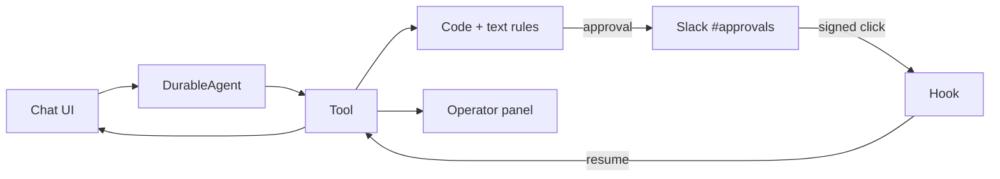

# Plaude Agent

Customer support agent for Acme Wallet, a fictional digital wallet, built for the Plaude engineering challenge.

[Open the chat](https://plaude-agent.vercel.app/chat) · [Stage 1 approval demo](https://plaude-agent.vercel.app/stage-1)

## 1. What it is

The agent helps a customer with their own account: balances, fees, transfers, limits and unlocks. Its behavior is plain text; its hard limits are code. When an action needs a human, the agent posts a Slack approval and the workflow waits without consuming compute.

The demo runs on three mock customers and never moves real money. It uses Next.js 16, Workflow DevKit's `DurableAgent`, and Slack ([D1](./DECISIONS.md#d1-nextjs-16-with-the-app-router), [D3](./DECISIONS.md#d3-workflow-devkit-workflow-v5-with-withworkflow), [D11](./DECISIONS.md#d11-pin-the-ai-sdk-stack-to-the-ai6-line-that-durableagent-requires)).

## 2. The principle

**The LLM converses, the rules decide.** The model picks tools and wording; it does not decide policy.

- **Resolves alone.** Read-only lookups and actions below every code threshold.
- **Human approval in Slack.** Fee refunds above USD 20, reversals above USD 100 or to a recipient already paid, limit increases above 2x, suspected-fraud unlocks, refunds and reversals on a fraud-locked account, and anything a text rule adds (D13, D20).
- **Hard block.** Any action on another customer's account or transaction is refused in code before a claim or an approval. No approver can allow it (D17).

There are five tools: `lookup_account`, `refund_fee`, `reverse_transaction`, `raise_limit` and `unlock_account`. Amounts, recipient status, lock reasons and current limits come from the wallet, never from the model (D17).

## 3. Architecture



One workflow owns a conversation. Tools run one at a time per conversation, and approval hooks resume only from the signed Slack endpoint (D14, D18).

## 4. Plain-text rules

`instructions/agent.md` is the source of truth for tone, scenarios and escalation. It ends with one optional `rules` block, read by code and never shown to the model:

```rules
rule raise_limit when account.locked is true reason "Raising the limit on a locked account"
```

The grammar has two forms:

```
rule <tool> when <fact> is <literal> reason "<label>"
rule <tool> when <fact> > <number> reason "<label>"
```

Rules only add approvals. There is no `allow`, `deny`, `and`, `or`, negation or arithmetic; several rules are ORed with the code rules, and no text can remove a code rule (D23). An invalid rule fails the build with `instructions/agent.md:<line>: <message>`, and the runtime validates the generated rules again (D22, D24). A missing `rules` block means zero extra rules.

## 5. Operator timeline

`/operator/[runId]` shows one conversation as a sequence of actions: what was requested, which rules fired (labeled CODE or TEXT), what was posted to Slack, who decided and when, and what the wallet did. It is the only place where the three levels are visible for the same run.

The panel is read-only. Approval remains in Slack, behind the signature check and the approver check, so the panel never becomes a second authorization path.

The records live in a namespaced durable stream (`timeline`), separate from the chat stream, so operator data never mixes with customer messages and no database is needed. The page polls every two seconds and stops when the run is terminal (D27).

## 6. Safety details

- **Slack signature.** Every click is verified as HMAC-SHA256 over `v0:<timestamp>:<rawBody>` and compared with `timingSafeEqual`; requests older than five minutes are rejected with `401` ([D6](./DECISIONS.md#d6-verify-slacks-hmac-signature-not-the-legacy-verification-token)).
- **Approvers.** Anyone who is a member of `#approvals` can decide, so approvers are managed in Slack; an optional explicit allowlist in `SLACK_APPROVER_IDS` is added to that membership. The check calls `conversations.members` and fails closed on a Slack error, a timeout or a missing channel ID ([D29](./DECISIONS.md#d29-authorize-approvers-by-approvals-channel-membership-plus-an-optional-allowlist)).
- **Cross-conversation lock.** A claim hook and a retained done marker allow one refund or reversal per transaction, even across conversations ([D26](./DECISIONS.md#d26-one-transaction-action-at-a-time-across-conversations-with-a-retained-done-marker)).
- **Ownership before the lock.** Another customer's transaction is refused before `claimTransaction` and before `requestApproval`; no approver can override it ([D17](./DECISIONS.md#d17-tools-trust-the-wallet-not-the-model)).
- **Timeout.** If nobody decides within 10 minutes (a durable `sleep`, so the wait uses no compute), the action is skipped and the tool returns `timed_out`; the agent reports that no human answered in time ([D8](./DECISIONS.md#d8-timeout-a-hook-with-a-durable-sleep)).
- **Stale or repeated clicks.** They do nothing and, when Slack sends the message blocks, mark it as no longer active while keeping any decision already there; the recorded decision remains in the operator panel ([D28](./DECISIONS.md#d28-retiring-a-stale-approval-message-keeps-the-recorded-decision)).
- **Long waits.** A long approval can outlast the chat stream cut by the 300-second function limit; `WorkflowChatTransport` reconnects to `GET /api/chat/[id]/stream` and replays the durable run stream. The route is read-only and never resumes an approval hook ([D18](./DECISIONS.md#d18-one-workflow-per-conversation-and-the-chat-api-cannot-resume-approvals)).

## 7. Tests

```bash
npm run test
```

47 tests on Node's built-in runner (no test dependency) cover:

- every approval threshold on both sides, in cents, plus the fraud-lock and ownership rules;
- additive text rules: they can add an approval and can never clear one;
- the rule DSL: valid `is` and `>` rules, unknown facts and tools, `and`, `allow` and `skip`;
- ownership order: `refund_fee` and `reverse_transaction` as Diego on Ana's fraud-locked transactions return `refused`, with zero claims and zero approval requests;
- Slack signature checks (valid, altered signature, altered body, old and malformed timestamps, wrong length), fail-closed approver authorization (allowlist, channel membership, Slack failure), inactive Slack blocks and USD formatting.

The suite was checked with manual mutations: moving the refund threshold, letting extra rules clear a code approval, and moving the ownership check after the rules or after the claim each make tests fail. `npm run build` also type-checks the tests.

## 8. Run it locally

Requires Node.js 22 or newer.

```bash
npm install
npm run dev
```

Open <http://localhost:3000/chat> for the agent, or <http://localhost:3000/stage-1> for the Stage 1 approval demo (`/` redirects to `/chat`). `npm run build` and `npm run test` work without Slack credentials or a `.env.local`.

Environment variables (names only; copy `.env.example` to `.env.local`):

| Name | Purpose |
|---|---|
| `SLACK_BOT_TOKEN` | Bot token with `chat:write` plus `channels:read` (public `#approvals`) or `groups:read` (private) |
| `SLACK_SIGNING_SECRET` | Verifies that requests come from Slack |
| `SLACK_APPROVALS_CHANNEL_ID` | Channel that receives approval requests |
| `SLACK_APPROVER_IDS` | Optional comma-separated Slack user IDs allowed to decide in addition to `#approvals` members |
| `GROQ_API_KEY` | Groq key for the primary model |
| `GOOGLE_GENERATIVE_AI_API_KEY` | Google AI Studio key for the manual Gemini fallback |
| `APP_BASE_URL` | Public origin used to build the View timeline link in Slack |

Slack app setup:

1. Create a Slack app and install it in the workspace.
2. Add the `chat:write` and `channels:read` bot scopes (use `groups:read` if `#approvals` is private) and invite the bot to `#approvals`.
3. Keep Socket Mode off. Under Interactivity, set the Request URL to `https://<your-deployment>/api/slack/interactions`. All Slack clicks go to this single endpoint.
4. Put the bot token, the signing secret and the approvals channel ID in `.env.local` and in Vercel.
5. Optional: add extra approver Slack user IDs to `SLACK_APPROVER_IDS`, comma-separated, in both places.

A click cannot reach `localhost`; use a public HTTPS deployment to exercise the full Slack loop. After changing environment variables in Vercel, redeploy. `APP_BASE_URL` builds the View timeline link in Slack; without it, the Slack button is omitted.

The model is chosen in one file, `lib/model.ts`: Groq `openai/gpt-oss-120b` is primary, Gemini `gemini-3.6-flash` is the manual fallback (D16).

## 9. Known limits

- **Mock state per run.** The wallet is an in-memory clone of `data/customers.json` for each conversation. Claims prevent duplicate refunds and reversals across runs, but balances are not shared: two different actions on one account can diverge (D26).
- **No panel auth.** Anyone with a run ID can read the operator timeline; there is no conversation list.
- **The run ID lives only in React state.** Refreshing the chat loses the link to the conversation, although the workflow and the Slack approval keep running.
- **Free tiers.** Groq allows 8,000 tokens per minute and Gemini is a manual fallback, not automatic failover. Only mock data is used: Groq does not train on API data, but Gemini's free tier may use prompts if an operator switches (D12, D16).
- **Newer agent API.** The brief asks for `DurableAgent`; Vercel's newer `WorkflowAgent` is a possible future migration (D3, D11).
- **No `request_human_input` tool yet.** For ambiguous requests, the agent asks a clarifying question and moves no money.

## 10. What's next

**Calibrate the rules with the decisions already recorded.** The timeline stores every approval, rejection and timeout per rule. From it: approval rate per rule (a rule approvers always accept is a candidate for review; one they often reject is earning its keep), automation rate, and time to decision. Use that evidence to lower, raise or remove rules instead of guessing.

After that: a shared wallet store with compare-and-set; `request_human_input` with a Slack modal; a prompt-injection filter in front of the model; authentication for the operator panel.

Every architectural choice and trade-off is in [DECISIONS.md](./DECISIONS.md).
